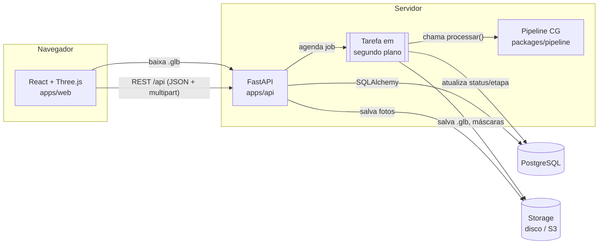

# 02 — Arquitetura

## Visão de componentes



## Fluxo principal: gerar um modelo

```mermaid
sequenceDiagram
    actor U as Usuário
    participant W as Web
    participant A as API
    participant D as PostgreSQL
    participant S as Storage
    participant P as Pipeline (segundo plano)

    U->>W: escolhe 3 fotos + tamanho (cm)
    W->>A: POST /modelos (multipart)
    A->>S: salva fotos
    A->>D: INSERT modelo, imagens, job(status=pendente)
    A-->>W: 202 {modelo_id, job_id}
    A->>P: agenda processar(job_id)
    loop a cada 1 s
        W->>A: GET /jobs/{id}
        A-->>W: {status, etapa_atual, progresso}
    end
    P->>D: etapa = segmentacao / alinhamento / visual_hull / marching_cubes / ...
    P->>S: salva modelo.glb (+ intermediários)
    P->>D: INSERT versao, arquivos; job.status = concluido
    W->>A: GET /modelos/{id}
    A-->>W: versão atual + URLs dos arquivos
    W->>U: visualizador 3D
```

## Onde a Computação Gráfica aparece em cada camada

| Camada | Conceitos de CG | Arquivos |
|---|---|---|
| Pipeline (back) | processamento de imagem (segmentação por distância de cor, morfologia), recorte e rotação da foto (afim 2D, F1-T11), rastreamento de contorno + Douglas–Peucker (F1-T12), projeção ortográfica, voxelização, visual hull, Marching Cubes, malhas poligonais, normais, suavização (Taubin), decimação (erro quádrico), projeção de textura, mapeamento UV, LOD | `packages/pipeline/src/relevo_pipeline/*` |
| Front | rastreamento de raios com BVH e raio de sombra (F2-T15); seleção por janela + recorte de triângulos contra planos e separação (F2-T14); recorte pelo plano near; pipeline de visualização 2D: janela→viewport, zoom/pan, recorte Cohen–Sutherland e Sutherland–Hodgman (F2-T10); plano de corte 3D com stencil (F2-T11); zoom no ponto (F2-T12); pipeline gráfico/rasterização (WebGL), câmera perspectiva, transformações por matrizes homogêneas 4×4 (F2-T13), iluminação e shading (flat × suave, PBR), shaders GLSL, raycasting, LOD por distância | `apps/web/src/components/*` |
| Banco | representação persistente de malhas e versões, matriz de transformação 4×4 por versão, parâmetros e métricas do pipeline (reprodutibilidade) | `apps/api/src/relevo_api/models.py` |

## Estrutura de pastas (Fases 0 a 5 concluídas)

```
apps/api/src/relevo_api/
├── main.py            # cria o app, CORS, inclui routers (modelos, publico, jobs, arquivos, conta, auth, amostras)
├── config.py          # Settings (.env: banco, storage local/S3, JWT)
├── db.py              # engine, sessão, Base
├── models.py          # ORM: usuarios, movimentos_credito, modelos, imagens, jobs, versoes, arquivos
├── schemas.py         # Pydantic (entrada/saída da API)
├── storage.py         # interface Storage + LocalStorage + S3Storage (MinIO / S3)
├── routers/
│   ├── auth.py        # POST /auth/registrar e POST /auth/login (F4-T01)
│   ├── conta.py       # GET /me e POST /creditos/recarregar (F4-T02)
│   ├── modelos.py     # CRUD + versões 4×4 + regerar máscara + rotas públicas /publico/{id}
│   ├── jobs.py
│   └── arquivos.py    # download e exportação sob demanda .glb/.obj/.stl (F4-T05)
└── servicos/
    ├── auth.py            # hash scrypt + tokens JWT HS256 (F4-T01)
    ├── creditos.py        # débito SELECT FOR UPDATE, estorno automático e extrato (F4-T02)
    ├── modelos.py         # valida o upload, cria/lista/detalha/apaga, versões e exportação
    └── processamento.py   # executa o pipeline e atualiza o job (F3-T05, F5-T05)

apps/web/src/
├── pages/            # Home, NovoModelo, Modelos, ModeloDetalhe, Conta, Entrar, Cadastrar, EmbedModelo, Guia, Visualizador, Fotos
├── components/       # ui/ (base), AppLayout, ModelViewer, VisorFoto, UploadSlot, EditorFoto, EditorMascara, RaioX, CenaRaioX…
├── lib/              # api.ts, consultas.ts, matrizes.ts, camera.ts, visualizador.ts, corte.ts, selecao.ts, rastreamento.ts…
├── testes/           # auxiliares dos testes (provedores, fetch falso)
└── shaders/          # GLSL customizados: altura.vert/.frag e fresnel.vert/.frag (F2-T05)
```
