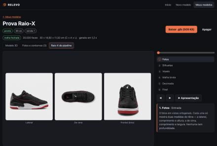
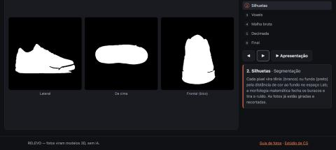
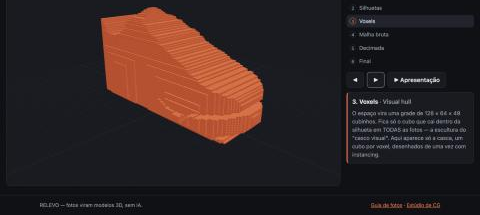
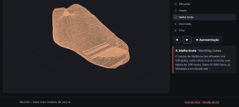
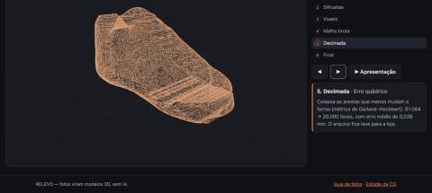
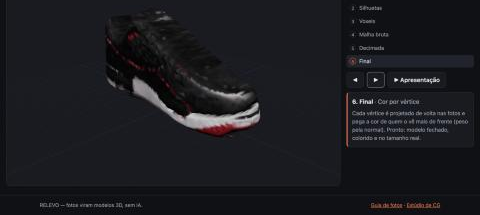

# Apresentação — roteiro, slides e perguntas da banca (F5-T07)

> Base para os slides e o ensaio. Tempo-alvo: **15 min + perguntas** (ajustar quando a data e o tempo forem
> definidos — STATUS, "Pendências sem dono"). Cada integrante apresenta a parte que construiu: preencher os nomes
> na coluna **Quem** antes do ensaio.

## Antes de começar (checklist do dia)

- [ ] `make api` e `make web` rodando; `/health/db` responde `ok`.
- [ ] Um modelo de exemplo já gerado em "Meus modelos" (se a internet ou o banco caírem durante a demo ao vivo).
- [ ] Tênis + fundo liso + celular para a foto **ao vivo** (aceite da F5-T07: demo a partir de fotos tiradas na hora).
- [ ] Vídeo de backup da demo aberto em outra aba (roteiro em `docs/revisoes/fase-3.md`).
- [ ] Navegador em tela cheia, zoom 100 %, notificações desligadas.

## Slides

| # | Slide | Conteúdo | Quem | Tempo |
|---|---|---|---|---|
| 1 | **RELEVO** | "Três fotos do seu tênis viram um modelo 3D em escala real — sem IA." Nome do grupo, disciplina. | | 0:30 |
| 2 | **O problema** | Loja online quer o tênis em 3D; modelar à mão custa caro e exige software especializado; fotogrametria pede dezenas de fotos. | | 1:00 |
| 3 | **A solução** | Lojista tira 2–6 fotos guiadas, informa o comprimento em cm e baixa um `.glb` em segundos. Sem escolhas técnicas (ADR 0009). | | 1:00 |
| 4 | **O pipeline, etapa por etapa** | As 6 imagens reais abaixo, em sequência (mesma ordem do Raio-X). Uma frase por etapa. | | 3:00 |
| 5 | **Arquitetura** | 3 camadas: front (React + Three.js) → API (FastAPI) → banco (PostgreSQL) + Storage; o pipeline em Python roda em segundo plano e avisa o progresso. Diagrama de `docs/02-arquitetura.md`. | | 1:30 |
| 6 | **Demo ao vivo** | Foto na hora → `/novo` → etapas ao vivo → estúdio 3D (zoom no ponto, recorte, transformar, rastrear raios) → **Raio-X** em modo apresentação → baixar. | | 5:00 |
| 7 | **O que o algoritmo não consegue** | Abertura do pé fechada; formato visto de frente estimado; sem foto do outro lado → espelhado; fundo parecido com o tênis separa mal. Dizemos isso na tela. | | 1:00 |
| 8 | **Números** | Malha fechada sempre; 20 mil faces; ~1 s por modelo; IoU 0,91–0,997; testes automatizados (pytest, Vitest, Playwright). Erro dimensional: resultado da F0-T10. | | 1:00 |
| 9 | **Próximos passos** | Textura UV (F4-T06), suavização de Taubin (F1-T02), LOD, régua 3D, incorporar na loja (F5-T06). | | 0:30 |

### Imagens do slide 4 (tenis-01, geradas pelo próprio Raio-X)

| Etapa | Imagem | Frase |
|---|---|---|
| 1. Fotos |  | Vistas ortogonais: cada foto só mostra duas medidas. |
| 2. Silhuetas |  | Segmentação: distância de cor no espaço Lab + morfologia matemática. |
| 3. Voxels |  | Visual hull: fica o cubo que cai dentro da silhueta em todas as fotos (desenhado com *instancing*). |
| 4. Malha bruta |  | Marching Cubes sobre o campo de distância, já com a seção transversal: ~61 mil faces, fechada. |
| 5. Decimada |  | Erro quádrico (Garland–Heckbert): 61 mil → 20 mil faces, erro médio 0,03 mm. |
| 6. Final |  | Cor por vértice: cada vértice pega a cor da foto que o vê mais de frente. |

## Demo ao vivo (slide 6) — passo a passo

1. Tirar a foto lateral e a de cima do tênis do grupo (fundo liso, câmera afastada + zoom — `/guia`).
2. `/novo`: mostrar o **gabarito**; enviar as fotos; em **Ajustar**, recortar se pegou algo a mais.
3. Comprimento medido com fita → **Gerar modelo 3D**. Mostrar as etapas avançando.
4. Estúdio 3D: **Ampliar** no ponto (raycasting) · **Recortar** (plano de corte com *stencil*) · **Transformar** (matriz
   4×4 na tela) · **Rastrear raios** (imagem por ray tracing ao lado da rasterização).
5. **Raio-X do pipeline** → **▶ Apresentação** (avança sozinho a cada 4 s). Narrar cada etapa em ~10 s.
6. **Baixar .glb**. Se sobrar tempo: "Fotos e contornos" com o contorno colado no tênis, ampliado 8×.

Plano B: se a foto ao vivo segmentar mal (fundo parecido), usar o modelo já gerado e explicar o aviso que apareceu —
é o valor "transparência sobre os limites" funcionando.

## Perguntas prováveis da banca

**Por que não usaram IA?** Requisito da disciplina (ADR 0001) e escolha de produto: tudo o que o RELEVO faz é
explicável passo a passo e sabemos onde ele erra. Uma rede neural "inventaria" as partes que nenhuma foto mostra.

**Por que a abertura do pé fica fechada?** É o limite teórico do visual hull: ele só sabe o que é **fora** de alguma
silhueta. Uma concavidade (a abertura vista de cima fica dentro do contorno do tênis) não aparece em nenhuma silhueta,
então nada a "esculpe". Só uma técnica com profundidade (fotometria, luz estruturada, IA) resolveria.

**Por que voxels e não direto a malha?** Interseção de cones de silhueta é simples numa grade: um voxel fica se a
projeção dele cai dentro de todas as máscaras. Depois o Marching Cubes transforma a grade em triângulos. Usamos o
campo de distância assinada (não só 0/1), então a superfície sai sem "degraus" (ADR 0005).

**O que é o Marching Cubes?** Para cada célula 2×2×2 da grade, os 8 cantos são classificados dentro/fora → 256
casos; uma tabela diz quais triângulos gerar; o vértice é interpolado na aresta onde o campo cruza zero.

**Por que a forma não fica "quadrada"?** Com 3 vistas o visual hull é uma caixa arredondada só nas bordas das
silhuetas. A **seção transversal comum** (ADR 0007) supõe que todas as fatias do tênis têm o mesmo perfil, só mudando de
tamanho — arredonda o bico. É uma hipótese e dizemos isso ao usuário.

**Por que Taubin e não Laplaciano?** O Laplaciano move cada vértice para a média dos vizinhos e **encolhe** o modelo
a cada passo. Taubin alterna um passo para dentro (λ) e outro para fora (μ < −λ) — filtro passa-baixa sem encolher.
(Ainda é refinamento planejado, F1-T02: o campo de distância já tirou a maior parte da "escada".)

**Como a matriz de transformação é composta?** Matrizes homogêneas 4×4: `M = T · R · S` (escala, depois rotação,
depois translação — a ordem dos motores 3D; o estúdio também mostra `S · R · T` para comparar). Com pivô `p`:
`M = T(p) · R · S · T(−p)` — leva o pivô para a origem, gira/escala, devolve.

**Como funciona o "zoom no ponto"?** Raycasting: um raio sai da câmera pelo pixel do cursor, achamos o ponto do modelo
que ele atinge e a câmera anda (*dolly*) em direção a esse ponto, não ao centro.

**Rastreamento de raios × rasterização?** A GPU rasteriza: projeta cada triângulo e preenche pixels. O ray tracing faz
o contrário: um raio por pixel, uma BVH descarta as caixas que ele não cruza, Möller–Trumbore acha o triângulo e um
raio de sombra decide se o ponto está iluminado. Fica lado a lado no estúdio.

**O que é instancing (no Raio-X)?** Milhares de cubos de voxel desenhados numa única chamada: a mesma geometria com
uma matriz 4×4 por instância, em vez de milhares de objetos.

**Como garantem a escala real?** O usuário informa o comprimento (calcanhar → bico); a malha é escalada para que a
extensão em x seja exatamente esse valor e apoiada em y = 0. O erro dimensional medido com fita está na F0-T10.

**E foto de celular tem perspectiva…** O algoritmo assume vista ortográfica; por isso o guia pede câmera afastada + zoom.
Quando a foto frontal não bate com a lateral e a de cima, a métrica `razao_frente` dispara um aviso.

**Como sabem que o modelo está certo?** Reprojetamos o volume nas fotos e comparamos com as silhuetas (IoU > 0,90 em
todos os tênis de teste); a malha é sempre fechada; e há testes automatizados para cada etapa e o fluxo inteiro (E2E).

## Ensaio

- [ ] Ensaio 1 cronometrado — tempo total: ____
- [ ] Ensaio 2 com a demo ao vivo a partir de foto tirada na hora
- [ ] Vídeo de backup gravado (link: ____)
